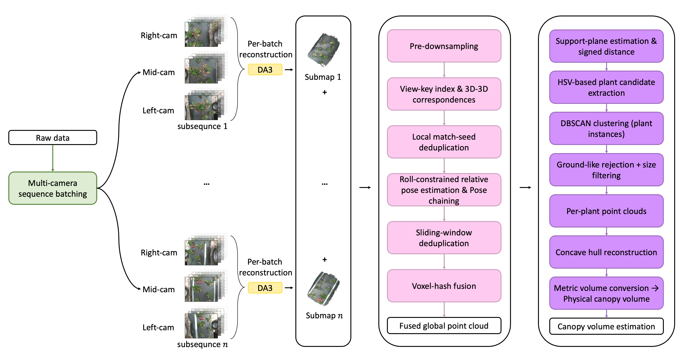

# SDrAwberry

A scale-referenced long-sequence 3D reconstruction and plant-level canopy-volume estimation pipeline for strawberry field phenotyping.



## Overview

SDrAwberry is a Python pipeline for synchronized multi-camera RGB sequences collected along strawberry beds. It prepares overlapping temporal batches from long image sequences, runs Depth-Anything-3 / DA3-style feed-forward multi-view reconstruction per batch, exports COLMAP-compatible sparse models and point clouds, and fuses per-batch submaps into a global point cloud.

Fusion is streamed and uses cross-batch COLMAP track correspondences, roll-constrained pose estimation for near-linear bed-aligned robot traversal, duplicate suppression, and voxel-hash fusion. In the current coordinate convention, roll-constrained alignment is implemented as a single-axis rotation around the reconstruction y-axis plus translation.

Downstream plant extraction estimates a support plane, computes signed plane-relative distances, applies HSV-guided plant candidate extraction, runs DBSCAN clustering, and rejects ground-like planar clusters. Plant-level canopy volumes are estimated by reconstructing watertight alpha-shape concave hull meshes. Metric interpretation requires reference-object-based scale recovery, such as known reference-object dimensions or an externally measured scale factor.

## Installation

### Conda + Editable Pip

```bash
conda create -n sdrawberry python=3.10 -y
conda activate sdrawberry
pip install -e .
```

### Conda Environment File

```bash
conda env create -f environment.yml
conda activate sdrawberry
```

### Pip

```bash
python -m venv .venv
source .venv/bin/activate
pip install -e .
```

Major dependencies:

- Python >= 3.10
- numpy
- scipy
- open3d
- opencv-python
- matplotlib
- pyyaml
- tqdm
- pycolmap
- trimesh
- torch, if required by your DA3 installation
- Depth-Anything-3 / DA3 CLI as an external dependency

DA3 must be installed separately according to its own license and installation instructions. This repository calls the external `da3` command and does not vendor or redistribute DA3 source code.

## Expected Data Layout

Input scene:

```text
scene_dir/
  images/
    <camera_id_1>/
      rgb/
        rgb_<frame_id>.png
    <camera_id_2>/
      rgb/
        rgb_<frame_id>.png
    <camera_id_3>/
      rgb/
        rgb_<frame_id>.png
```

After batching and DA3 export:

```text
scene_dir/
  batches/
    01/
      images/
        <frame_id>_<camera_id>.png
  sparse/
    01/
      cameras.bin
      images.bin
      points3D.bin
      points.ply
```

After fusion, clustering, and meshing:

```text
scene_dir/
  merged/
    merged_global.ply
  clusters/
    cluster_0001.ply
    cluster_0002.ply
  meshes/
    cluster_0001/
      cluster_0001_m*.ply
      summary_concave.json
```

## Quickstart

Batching and DA3:

```bash
python scripts/run_batching.py \
  --scene_dir /path/to/scene \
  --batch_size 10 \
  --overlap_frames 5 \
  --symlink \
  --da3_export_ply
```

Fusion:

```bash
python scripts/run_fusion.py \
  --base_dir /path/to/scene \
  --sparse_subfolder sparse \
  --ply points.ply \
  --out /path/to/scene/merged/merged_global.ply \
  --window_kdt 4 \
  --window_match 2 \
  --pre_voxel 0.003 \
  --voxel 0.002
```

Clustering:

```bash
python scripts/run_clustering.py \
  --input_pcd /path/to/scene/merged/merged_global.ply \
  --out_dir /path/to/scene/clusters \
  --dbscan_eps 0.015 \
  --dbscan_min_pts 120 \
  --plane_dist_threshold 0.005 \
  --z_axis_inverted
```

Concave hull:

```bash
python scripts/run_concave_hull.py \
  --in_pcd /path/to/scene/clusters/cluster_0001.ply \
  --out_dir /path/to/scene/meshes/cluster_0001 \
  --alpha_voxel 0.006 \
  --alpha_m_list "2,3,4,5,6,7,8,9,10,15,20" \
  --min_triangles 2000 \
  --fill_holes \
  --save_only_selected
```

Full pipeline:

```bash
python scripts/run_full_pipeline.py \
  --config configs/example_scene.yaml
```

## Configuration

The `configs/*.yaml` files provide stage defaults and can be overridden by CLI flags:

- `configs/batch.yaml`
- `configs/fusion.yaml`
- `configs/clustering.yaml`
- `configs/concave_hull.yaml`
- `configs/example_scene.yaml`

For example:

```bash
python scripts/run_fusion.py --config configs/fusion.yaml --base_dir /path/to/scene --voxel 0.002
```

## Dataset

The public dataset will be available at:

https://huggingface.co/datasets/Sycamorers/SDrAwberry

Status: Dataset upload in progress. The README will be updated once the dataset is fully available.

After download, place each scene under a local directory using the layout described above, for example:

```text
/path/to/SDrAwberry_data/
  scene_001/
    images/
      <camera_id>/
        rgb/
          rgb_<frame_id>.png
```

Do not commit raw images, sparse models, point clouds, meshes, zip files, or dataset downloads to git.

## Output Interpretation

DA3-style feed-forward reconstructions may be internally consistent but non-metric before reference-object scale recovery. Before interpreting volumes in physical units, provide known physical reference-object dimensions or an externally measured scale factor. Without scale recovery, volumes are reported in reconstruction units.

## Limitations

- Outdoor illumination variation can affect reconstruction quality and HSV thresholds.
- Unsupervised clustering may over-segment a plant or merge connected canopies.
- DA3 memory usage depends on the number of views and image resolution.
- Absolute metric scale requires reference objects or external calibration.

## Citation

If you use SDrAwberry in your research, please cite:

Huang, Z., Lee, W. S., Qin, R., Medeiros, H., Jeon, H., & Zhu, H. (2026). SDrAwberry: Scale-referenced Depth-Anything-3 long-sequence reconstruction for Strawberry canopy volume estimation. *Computers and Electronics in Agriculture*, 252, 112088. https://doi.org/10.1016/j.compag.2026.112088

BibTeX:

```bibtex
@article{huang2026sdrawberry,
  title = {SDrAwberry: Scale-referenced Depth-Anything-3 long-sequence reconstruction for Strawberry canopy volume estimation},
  author = {Huang, Zijing and Lee, Won Suk and Qin, Ruoyao and Medeiros, Henry and Jeon, Hongyoung and Zhu, Heping},
  journal = {Computers and Electronics in Agriculture},
  volume = {252},
  pages = {112088},
  year = {2026},
  doi = {10.1016/j.compag.2026.112088},
  url = {https://www.sciencedirect.com/science/article/abs/pii/S0168169926006836}
}
```

## License

This repository is released under the MIT License. Third-party dependencies, DA3, and datasets may have separate licenses.

## Contact

GitHub: https://github.com/Sycamorers
